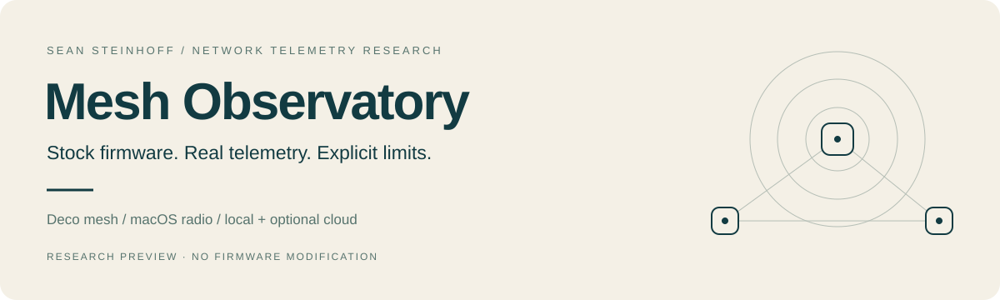
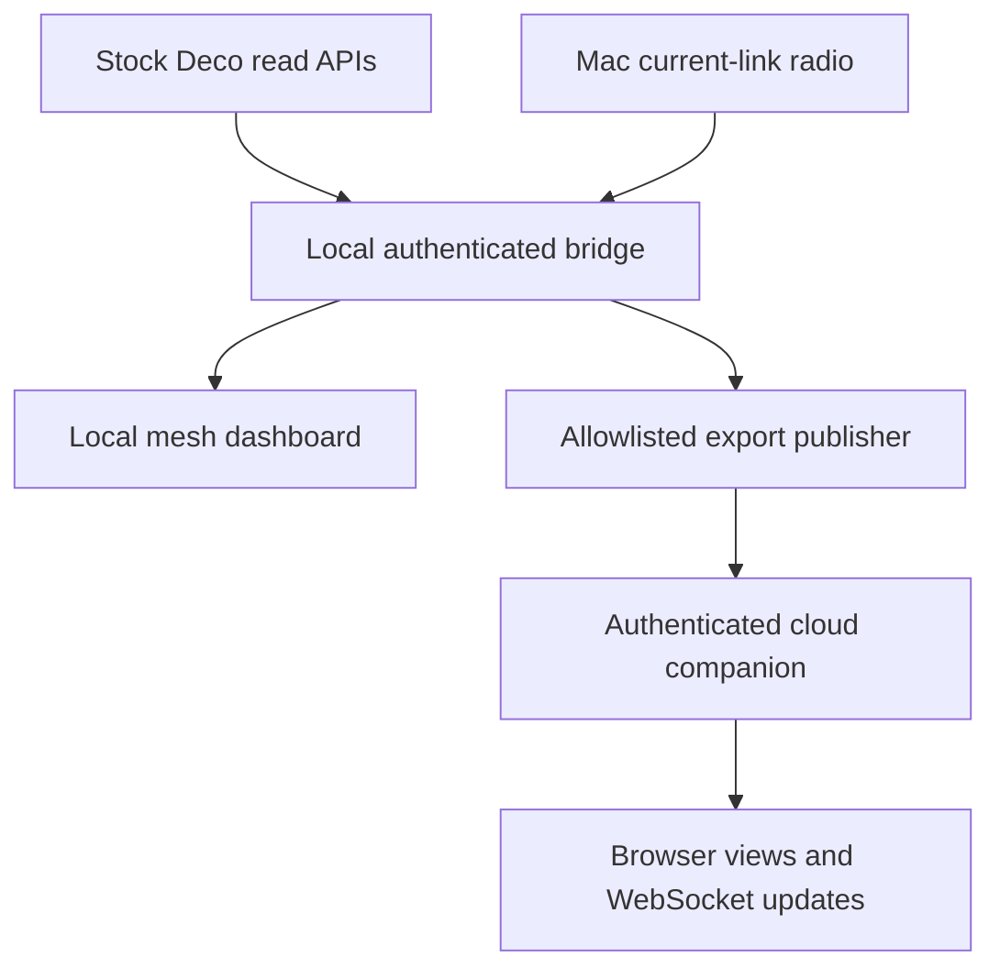

<picture>
  <source media="(prefers-color-scheme: dark)" srcset="assets/header-dark.svg">
  <source media="(prefers-color-scheme: light)" srcset="assets/header-light.svg">
  
</picture>

**A stock-firmware mesh telemetry research toolkit.** Read owner-authorized TP-Link Deco records, collect the Mac's current Wi-Fi link measurements, and inspect them through local and optional authenticated cloud interfaces.

[Quick start](#quick-start) · [Architecture](#architecture) · [Evidence and limits](#evidence-and-limits) · [Provenance](PROVENANCE.md)

Research preview · Python / Swift / JavaScript · MIT

## The question

How much useful network telemetry can you obtain from an existing consumer mesh without flashing hardware or changing router settings?

This project explores that boundary. It brings together stock Deco device/client records, macOS CoreWLAN measurements, device-to-node association observations and an optional live dashboard. Missing measurements remain unknown. A modeled coverage view stays visibly distinct from measured radio data.

It does **not** establish raw complex CSI export, human tracking, pose estimation, vital-sign sensing or validated movement detection from stock Deco hardware.

## What is here

| Component | Purpose |
|---|---|
| [Stock Deco collector](tools/deco_bridge/deco_bridge.py) | Bounded, authenticated read forms over certificate-pinned HTTPS; explicit target, no network sweep. |
| [Mac radio reader](tools/deco_bridge/mac_radio.swift) | Current-link RSSI, noise, channel and transmit rate through public CoreWLAN APIs. |
| [Local bridge](tools/deco_bridge/bridge_service.py) | Loopback-only API, source freshness, bounded retries and explicit connection recovery. |
| [Native Mac wrapper](tools/deco_bridge/MacApp.swift) | Unsigned local research app with in-memory owner sign-in. |
| [Export publisher](tools/deco_bridge/research_feed.py) | Rebuilds an allowlisted payload before optional outbound HTTPS publication. |
| [Cloud companion](tools/deco_cloud/) | Authenticated ingest and viewing, WebSocket updates and bounded telemetry retention. |
| [Association and RF views](tools/deco_cloud/rf-field-ui.mjs) | Node attachments, owner-authored floor plans and explicitly uncalibrated coverage models. |

## Engineering decisions

- **Respect the hardware boundary.** Read stock interfaces; no firmware flashing, factory resets or router configuration writes.
- **Preserve the meaning of a measurement.** Signal bars do not become dBm. A connected device does not become a person. A heartbeat does not become a fresh observation.
- **Fail visibly.** Stale, unavailable, synthetic and live-unverified states remain separate; missing values are not fabricated zeros.
- **Constrain authority.** Explicit private IPv4 target, same-socket certificate pinning, fixed read endpoints, loopback authentication and bounded retry budgets.
- **Minimize exported data.** Session aliases replace raw identifiers in the export. Timing and aliases can still be sensitive, so the cloud companion is authenticated.
- **Test the boundary cases.** Fixtures exercise invalid pins, authentication failures, stale records, reordered observations, export filtering and modeled-versus-measured distinctions.

## Architecture



The local route works independently of cloud deployment. The native RuView Rust sensing server is not included. Selected RuView UI components are retained for the optional bridge-mode view, with attribution in [PROVENANCE.md](PROVENANCE.md).

## Quick start

### 1. Clone and run the offline checks

Python 3.11+ and Node.js 22 are recommended for this preview. Swift/macOS is required only for the native components.

```sh
git clone https://github.com/dayumheroic/mesh-observatory.git
cd mesh-observatory
python3 -m venv .venv
.venv/bin/python -m pip install --only-binary=:all: -r tools/deco_bridge/requirements.txt
.venv/bin/python -m unittest discover -s tools/deco_bridge -v
node --test tools/deco_bridge/test_mesh_client.mjs tools/deco_cloud/test_*.mjs
```

These tests use synthetic responses and local test services. Passing them is not hardware acceptance.

### 2. Replay a synthetic sample

```sh
.venv/bin/python tools/deco_bridge/deco_bridge.py replay \
  --input tools/deco_bridge/synthetic.json
```

The output is explicitly synthetic. It is a way to inspect the contract without a router login.

### 3. Choose a live route

- [Local collector and certificate trust](tools/deco_bridge/README.md)
- [Build the unsigned native Mac app](tools/deco_bridge/APP.md)
- [Build and configure the optional cloud companion](tools/deco_cloud/README.md)

Use only hardware and networks you own or are authorized to administer. Live collection is a separate, explicit action. No live network collection or cloud deployment is needed to review the code.

## Evidence and limits

| Capability | Evidence status |
|---|---|
| Current-link Mac RSSI/noise/channel/rate | Recorded as measured in the source research on Intel macOS; not remeasured during this extraction. |
| Stock Deco device/client collection | Source research records successful owner-authenticated collection on the studied M5/M4R/E4R mesh. Compatibility is not universal. |
| Node association and cloud delivery | Source research records successful observations and authenticated delivery; no private captures or live endpoints are published here. |
| Offline contracts and boundary behavior | Rechecked during extraction; see [VALIDATION.md](VALIDATION.md). |
| RF coverage geometry | Owner-placed anchors and an uncalibrated model, not a measured spatial field. |
| Movement inference, localization and CSI | Unvalidated or unavailable. Not presented as working capabilities. |
| Long-running reliability and distribution | Sleep/wake, full resource budgets, Apple Silicon acceptance and signing/notarization remain open. |

An observed device-to-node change is not proof that a person moved between rooms. Raw traffic-rate units remain unverified where the source API does not establish them.

## My contribution

I am Sean Steinhoff. I defined the stock-firmware research scope and directed AI-assisted implementation of the Deco acquisition path, macOS bridge, telemetry contracts, verification boundaries and companion views. I own the architectural decisions and acceptance criteria.

This is a focused extraction from my RuView research branch. It is **not** a claim that I authored RuView, its sensing models or its original interface. Reused components and protocol references are documented in [PROVENANCE.md](PROVENANCE.md) and [THIRD-PARTY-NOTICES](THIRD-PARTY-NOTICES).

[GitHub](https://github.com/dayumheroic) · [Portfolio](https://seansteinhoff.com/) · [LinkedIn](https://www.linkedin.com/in/seantylersteinhoff/)

## Review and contribute

Useful review areas include exact-firmware compatibility, telemetry field semantics, recovery behavior and tests that expose unsupported inference. Use synthetic fixtures in public issues. Do not upload credentials, household captures, identifiers, room layouts or packet traces.

See [CONTRIBUTING.md](CONTRIBUTING.md) and [SECURITY.md](SECURITY.md). MIT license; retained third-party notices apply.
